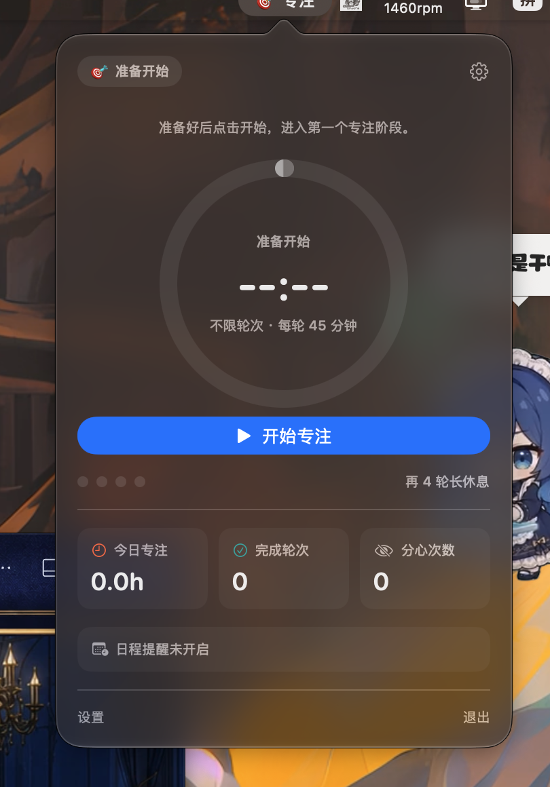
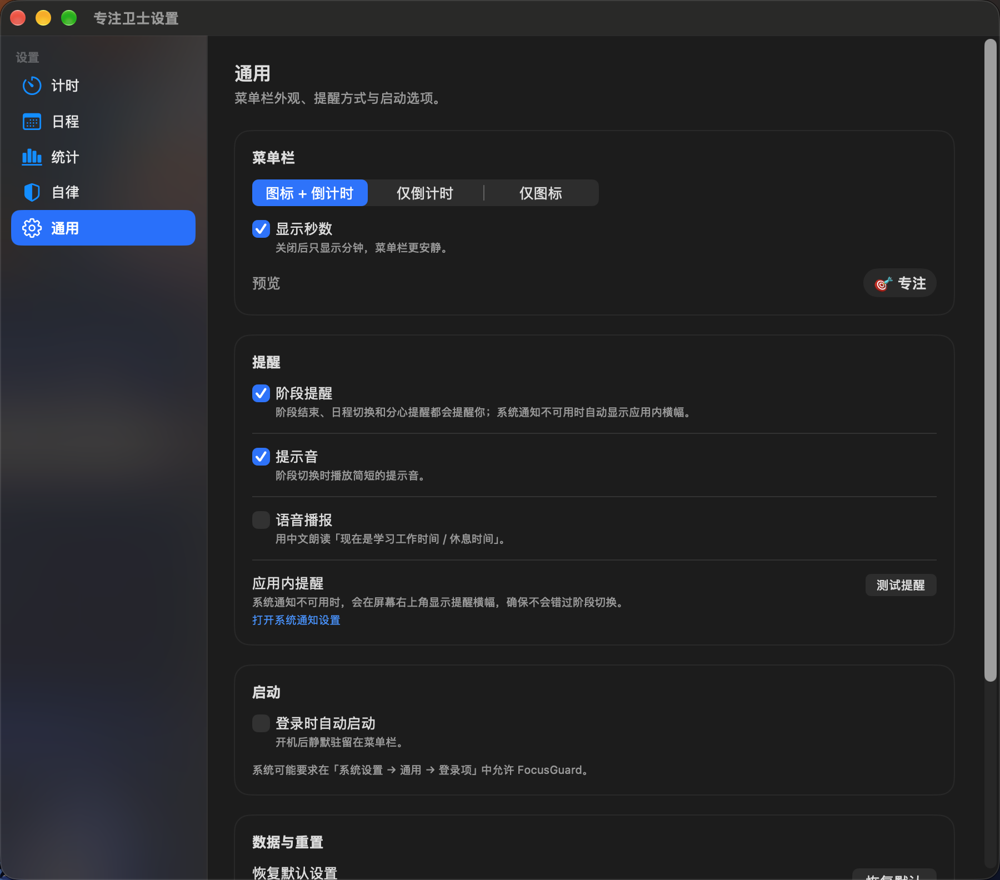

# 专注卫士 · FocusGuard

一个常驻 macOS 菜单栏的自律计时器：用「专注 + 休息」循环把你按在桌前，用时间段日程提醒你什么时候该学习、什么时候该休息，并顺手记录每天的专注数据。

没有账号、没有云同步、没有第三方依赖，所有数据都留在本机。



## 下载

从 [Releases](https://github.com/ThecangShengdance/FocusGuard/releases) 下载最新 `FocusGuard-1.0.0.zip`，解压后打开 `FocusGuard.app`。如果 macOS 提示无法验证开发者，先执行 `xattr -cr FocusGuard.app` 再打开。

## 功能

### 专注循环

- 自定义专注时长、短休息时长、长休息时长。
- 每完成 N 轮专注自动进入一次长休息，N 可调。
- 可设置总轮次；设为 0 表示不限，直到你手动终止。
- 每个阶段结束后自动开始下一阶段，也可以关掉自动开始，由你手动继续。
- 菜单栏实时显示当前阶段与剩余时间：专注橙色、短休息青色、长休息绿色、暂停灰色。
- 暂停 / 继续 / 跳过当前阶段 / 终止整个循环。
- 「跳过」不计入完成轮次，但会推进循环进度，适合临时有事的情况。
- 终止循环时，已专注超过 30 秒的部分会记入统计。

### 时间段日程

- 添加多条「学习/工作」或「休息」时间段，例如 09:00–12:00 学习、12:00–13:30 休息。
- 每条日程可选择星期（工作日、每天、周末或任意组合）。
- 到切换时间自动提醒；可选「进入学习时段时自动开始专注」。
- 重叠的启用时段会被编辑器拦截，避免同一时刻出现两个状态。
- 当前时段与下一个时段会显示在菜单栏弹窗里。

### 统计与目标

- 今日专注时长、完成轮次、分心次数。
- 最近 7 天专注柱状图。
- 连续专注天数。
- 每日专注目标与进度。
- 最近专注记录。
- 一键导出 CSV（包含专注记录与分心记录）。

### 自律辅助

- **分心应用监控**：专注期间切到微信、QQ、抖音等指定应用并停留超过设定秒数，会记录一次分心并提醒你。可在设置里从正在运行的 App 中添加任意应用。
- **空闲自动暂停**：连续一段时间没有键盘/鼠标操作时自动暂停计时，避免人离开后计时还在空转。默认 3 分钟，可关闭。
- **全局快捷键**：`⌃⌥S` 开始/暂停/继续，`⌃⌥K` 跳过当前阶段。
- **菜单栏样式**：图标 + 时间 / 仅时间 / 仅图标，可切换是否显示秒数。
- **提醒方式**：系统通知、提示音、中文语音播报可分别开关。系统通知不可用时自动改用屏幕右上角的应用内提醒横幅。
- **登录时启动**：通过 macOS 登录项注册。
- **本轮目标**：在弹窗顶部写一句「这一轮为什么而坐」。

## 系统要求

- macOS 14.0 或更高版本。
- 从源码构建需要 Xcode 16+；本项目在 Xcode 27.2 / Swift 6.4.2 上开发。
- 不支持沙盒分发，使用本地 ad-hoc 签名，适合自己构建自己用。

## 构建与运行

### 用 Xcode

1. 打开 `FocusGuard.xcodeproj`。
2. 选择 `FocusGuard` scheme，Run。
3. App 不会出现在 Dock 里，启动后看菜单栏右侧的 🎯 图标。

### 用命令行

```bash
./build.sh          # Release
./build.sh Debug    # Debug
```

脚本会把产物拷贝到 `Dist/FocusGuard.app`，执行 `xattr -cr` 并做 ad-hoc 签名。构建完成后：

```bash
open Dist/FocusGuard.app
```

也可以用 `scripts/make_icon.swift` 重新生成 AppIcon（在项目根目录执行 `swift scripts/make_icon.swift`）。

首次打开面板或设置时会请求通知权限。若系统未授权（ad-hoc 构建有时会被 macOS 直接拒绝），阶段结束和日程切换仍会在屏幕右上角显示应用内提醒横幅，不会漏掉提醒；在「通用 → 提醒」里可以测试横幅，或打开系统通知设置手动授权。

> 如果 macOS 提示 App 已损坏或无法验证，执行 `xattr -cr Dist/FocusGuard.app` 后再打开。每次重新构建并替换 App 后，系统可能重新询问通知/登录项权限。

## 使用

- **左键**菜单栏图标：打开控制面板。
- **右键**菜单栏图标：快速开始/暂停、跳过、终止、查看今日统计、打开设置、退出。
- **设置**分五页：
  - `计时`：阶段时长、长休息间隔、总轮次、自动开始、每日目标、本轮目标。
  - `日程`：时间段与星期、自动开始、启停。
  - `统计`：今日数据、7 日图表、最近记录、导出/清空。
  - `自律`：分心监控、空闲自动暂停、全局快捷键。
  - `通用`：菜单栏样式、通知/声音/语音、登录启动、恢复默认。



### 计时逻辑说明

- 专注结束 → 短休息；每完成 `长休息间隔` 轮专注 → 长休息；休息结束 → 下一轮专注。
- 设置 `总轮次` 后，完成指定轮数会结束整个循环并回到待机。
- 修改时长会立即保存；正在进行的阶段不受影响，从下一阶段开始生效。
- 暂停会保留剩余时间；跳过会直接进入下一阶段；终止会清空本轮循环进度。

### 日程逻辑说明

- 每条时间段只支持同一天内，结束时间必须晚于开始时间，不支持跨午夜。
- 同一星期内，启用中的时间段不能重叠。
- 日程切换只在 App 运行期间生效；App 退出后不会后台唤醒。
- 如果切换时你正在专注，日程提醒不会强行打断计时，只发通知。

## 数据与隐私

- 专注与分心记录：`~/Library/Application Support/FocusGuard/stats.json`
- 设置：`UserDefaults`（bundle id `com.zhangzhouqi.FocusGuard`，key `FocusGuard.settings.v1`）
- 分心监控只读取当前前台 App 的 bundle id，不截屏、不记录窗口内容。
- 空闲检测使用 `CGEventSource` 的键鼠空闲时间，不需要辅助功能权限。
- 全局快捷键使用 Carbon `RegisterEventHotKey`，同样不需要辅助功能权限。
- 没有任何网络请求。

## 项目结构

```
FocusGuard/
├── FocusGuard.xcodeproj
├── Sources/
│   ├── App/
│   │   ├── FocusGuardMain.swift    # @main、AppDelegate、状态栏、弹窗、设置窗
│   │   └── AppModel.swift          # 全局状态与业务编排
│   ├── Core/
│   │   ├── Models.swift            # Phase / TimerConfig / ScheduleBlock / AppSettings
│   │   ├── TimerEngine.swift       # 绝对时间驱动的阶段计时器
│   │   ├── ScheduleEngine.swift    # 时间段解析与切换检测
│   │   ├── StatsStore.swift        # 本地统计与 CSV
│   │   ├── NotificationService.swift # 系统通知 + 应用内提醒兜底
│   │   ├── ReminderPresenter.swift   # 右上角提醒横幅
│   │   ├── SoundPlayer.swift
│   │   ├── LaunchAtLogin.swift
│   │   ├── IdleMonitor.swift
│   │   ├── DistractionMonitor.swift
│   │   └── GlobalHotKey.swift
│   ├── Views/                      # 弹窗、环形进度、五个设置页
│   └── Resources/Assets.xcassets
├── scripts/make_icon.swift
├── build.sh
└── README.md
```

## 已知限制

- 时间段不支持跨午夜（例如 23:00–01:00），需要拆成两条或等到后续版本。
- 电脑睡眠期间不会补算多个已经错过的循环；唤醒后按当前阶段剩余时间继续/结束。
- 分心监控依赖前台 App 切换事件，不能识别同一 App 内刷视频。
- 登录启动在 ad-hoc 签名、非 `/Applications` 路径下可能被系统拒绝，可在「系统设置 → 通用 → 登录项」中手动允许。
- 没有单元测试 target；核心计时逻辑通过运行 App 与快捷键实测验证。

---

## 许可证

[MIT](LICENSE)
